It is so, SO cool that Notion supports mermaid diagrams now!

You may be wondering:

1. What is mermaid and why would I use it?
2. How/where can I edit mermaid diagrams?
3. What do I need to know to start being productive with mermaid in Notion?

That’s exactly what you’ll learn in this article! Feel free to skip around. 

## What Is Mermaid?

### About Mermaid

#### **Text-to-Diagram**

Mermaid is a “text-to-diagram” tool. This means you can type out what you mean in text like `step1 --> step2` , and let the software figure out where to put things for you. Some people call text-to-diagram tools “markdown for diagrams”. It’s a great comparison, because both markdown and these text-to-diagram tools help you focus on content and structure, instead of getting distracted with the fiddly bits of design. You can focus on how things relate, and NOT have to drag around boxes and arrows manually, always fiddling with them to make them line up etc.

#### **Plenty Pretty**

Sometimes you do want to control exactly how a diagram looks, like for marketing materials, but often the computer-generated diagram is pretty darn good! Text-to-diagram tools are a great middle ground for a team to use together. They make decent enough looking diagrams that anyone can edit. A web designer can use CSS to give them standard formatting and the company font. As a bonus, your team doesn’t have to buy a software license for these either!

#### **A Great Choice**

Mermaid is not the only text-to-diagram tool, but it’s one of my favorites! It’s flexible, easy to learn, and has great documentation. The web editor mermaid.live is also pretty memorable — easy to pull up when you need it. 

Just to give you an idea of the landscape here: my top two tools are graphviz and mermaid, and I use them both a lot. PlantUML is another popular tool. I’ve even auto-generated database diagrams using rails-erd, and that uses graphviz under the hood. Each tool has strengths and weaknesses, but that’s the topic for another post. 

#### Mermaid’s Diagram Types

The three types I use the most often are: Flowcharts (this tutorial), Sequence Diagrams, and Entity Relationship Diagrams (for databases). Mermaid offers many more types, including: class diagrams, state diagrams, user journey diagrams, gantt charts, and pie charts.

### Example Flowcharts

Two of my most recent / favorite diagrams. One is a curriculum order/dependency chart, and the other is a diagram of how queer terms map to each other.

#### Example 1 - Happy and Effective Curriculum

This is my course curriculum for workshops I offer through Happy and Effective. There is an order to things, some workshops build upon earlier ones. It’s also not perfectly linear - I often do rearrange the order of these for a client.

Before I drew out this diagram, even I didn’t fully understand how my courses related to each other. I did know for a single course what other courses it related to — but I definitely did not have this full diagram mapped in my head. Without mermaid’s help, I would not have drawn this diagram at all — it wouldn’t have been worth it.


A diagram of the 25 workshops Happy and Effective offers, and how they map to each other. This is an example of a client that has already completed some workshops (blue) and I’m recommending the next 6 they asked for be the highlighted ones (green).

#### Example 2 - What’s in LGBTQIA?

Even queer people have trouble keeping track of all the letters sometimes! This diagram is from our LGBTQIA inclusion workshop, where we build up a shared understanding of the letters here a few at a time.

In this diagram I’m pointing out the “IA” at the end as I talk through them. (Note: there is no “ally” in LGBTQIA according to all the queer people I’ve talked to about this. We love allies, but we need a term to describe the people directly affected. Feel free to ask me about it sometime, I have a lot to say about this!!)


A breakdown of LGBTQIA: Lesbian, Gay, Bi, Asexual/Aromantic map to sexual/romantic orientation. Trans and Intersex map to gender identity. Queer is an umbrella to the rest.

### Mermaid in Notion = Realtime Collaboration!

#### **Realtime Collaboration.**

While graphviz and mermaid have had web editors for a while now, they’ve all been missing a key feature: realtime collaboration. Think Google Docs - at first it might have been chaotic to have multiple cursors around, but after each team gets the hang of it, it’s **better** that whiteboards ever were. I like GitLab’s article that explains the pros and cons of whiteboards vs Google Docs. The team gets a shared mental model faster, more peoples’ voices are heard, and it’s faster and more efficient than an in-person whiteboard.

#### **2017: so close, but so far**

In 2017, I wrote what is now the most-starred graphviz tutorial on github.

I tried to make my own realtime collaborative diagramming tool based on graphviz. It did work! I wasn’t super happy with it though, because I wanted BOTH syntax highlighting AND multiple cursors in the same app. I got etherpad to do multiple cursors, or codemirror to do syntax highlighting, but I couldn’t put them together.  Luckily, today we have both syntax highlighting AND multiple cursors — in Notion!

#### **Now In Notion!**

I got SO excited when Notion announced mermaid support in code blocks earlier this week. This is the best news for realtime collaboration in a very long time.  I immediately messaged a lot of tech friends about it. You must have heard my excitement, too!!

https://twitter.com/NotionHQ/status/1475904423561891840?s=20

### Mermaid Works in GitHub now too!

Here's their blog post about it
https://github.blog/2022-02-14-include-diagrams-markdown-files-mermaid/

You just need to include it in a mermaid “code fence” like this:

```
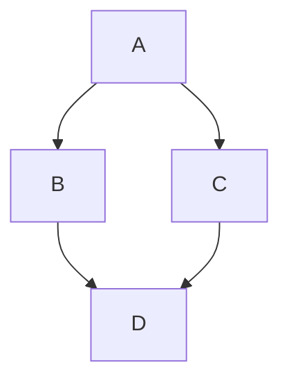
```

## Mermaid Flowchart Tutorial

The mermaid docs are really, very good — but as a new user, it’s still a lot to take in from the documentation directly. Here I’ll go through each concept and gotcha step by step, one at a time. I especially like including mnemonics and the “why” behind some of the quirks. These things are what really helped me learn mermaid:

- Where to Mermaid
    - Mermaid in Notion
    - mermaid.live
    - text editor plugin
- Basics
    - boxes and arrows
    - text vs id
    - multi-word text nodes
- Advanced
    - multi-line text
    - arrow styles
    - arrow labels
    - flowchart direction
    - subgraphs
    - graph title
- Styling
    - theme styling
    - box shapes
    - box styling

Diagramming should be fun, like solving a puzzle! If we were in a workshop together, this is where I would turn on some puzzle-solving background music like “My Favorite Trick” from the game BoF III. These are my favorite tricks! ✨

### Where to Mermaid

Once you have one of these set up, skip on down to the Basics. There are roughly three places you might use mermaid: in Notion, on the web at mermaid.live, or as a text editor plugin. 

#### Mermaid In Notion

Notion supports this now! How to get started:

1. Optional: Create a private page “Mermaid Testing” to play around in.
2. Create a code block (like by using `/code`).
3. Change the language to `mermaid`.
4. Just to see it working, I like to start new mermaid code blocks with `graph TB` as my first line and `A --> B` as my second line.

#### Mermaid Web Editor (mermaid.live)

Want to collaborate on a diagram with someone who doesn’t use Notion?

Try mermaid.live! This mermaid official site saves your image in the URL of the mermaid.live page, updating as you edit. I often bookmark checkpoints as I go in case I need to use something from an older version, but the tool also saves revision history in-browser.

You can even use this site to directly embed an image into markdown (like on github).

#### Mermaid in a Text Editor

There are mermaid plugins for all the major text editors, including VSCode (my editor lately). Mostly I just reach for mermaid.live, or now Notion — but I do use the text editor plugin for some software projects that track diagram files in the github repository.

For graphviz I’ve even used a shell script to auto-generate files from their source text files. I would do the same for mermaid if that came up for me.

### Basics

#### Boxes = Nodes, Arrows = Links

A lot of people stumble over the formal terms  `nodes` and `links` at first. I did! You can colloquially call these `boxes` and `arrows`, and that’s what I’ll call them in this tutorial.

Why don’t the docs use these simple words? Well, the boxes aren’t always box-shaped and the arrows don’t always have arrowheads.

Eventually you can get used to calling them their formal names `nodes` and `links`, but for this tutorial I’ll call them `boxes` and `arrows`.

- Terms Source Code
    
    ```mermaid
    flowchart TB
    subgraph Formal Terms
    	n1["nodes"] --links--> n2["nodes"]
    end
    subgraph Colloquial Terms
    	b1["boxes"] --arrows--> b2["boxes"] 
    end
    ```
    


#### Text vs id

You can get away without thinking about the difference between text and ids if all of your boxes are single words with no spaces. 

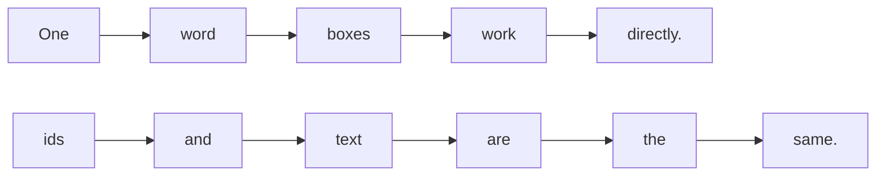


#### Multiple Words? It needs an id

Want a multiple-word box? That box also has to have an id, and it uses this syntax `boxid["Box Text"]`: 

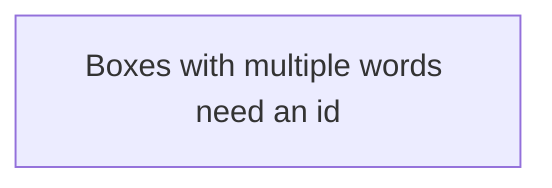


Often the ids are really helpful! For example, imagine you have a box with a lot of arrows coming to/from it. You can use a id to refer to these without typing the long text over and over. And editing the is easier since it’s in one spot, too!

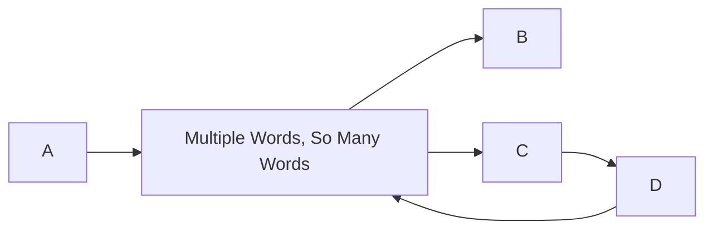


Sometimes, however, the id/text syntax is unhelpful. I get frustrated when I have a simple graph with very few connections, and I have to make up an id that I’ll never use. Here’s an example with id `lol`. Despite this bit of friction, I’m still glad to be using this tool!

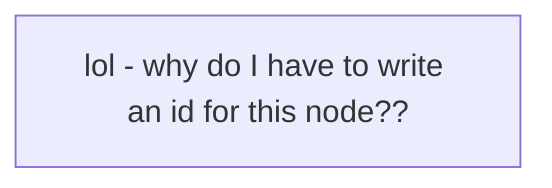


#### Quotes Needed Sometimes

If you are using any special characters like the  `)` in `:)`, you may need to use quotes, too.

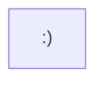

### Advanced

#### Multiple Lines (br)

Sometimes you have a lot of text to put in a box! You can make line-breaks by using the html-style `<br>` tag in your text to accomplish just that.

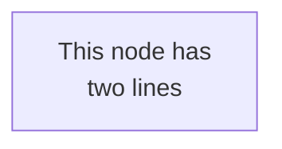


Watch out on Notion though — there is a Notion bug where it cuts off multi-line text, at least as of December 29, 2021. Multi-line does behave just fine on mermaid.live though!

#### Arrow Styles

I have a lot of trouble remembering to use TWO dashes for my lines `-->`. One dash seems like plenty, but it throws an error! Not supporting `->` is probably helpful for parsing the text too, but how can we make that easy to remember?

- NOT `->` (even though I type this a lot! lol oops)

Two-dashes became much easier for me to remember once I added  dotted lines `.->` into my repertoire. I mean `.>` doesn’t look like an arrow at all, of course it needs that dash `.->`! For consistency reasons, `-->` kinda makes sense too. 

Here’s a list of arrow styles in order of how often I use them:

- `-->` regular arrow
- `.->` dotted arrow
- `--->` long arrow
- `==>` thick arrow
- `---` headless arrow

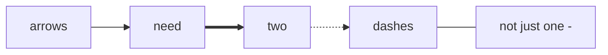


#### Arrow Labels

How do you label an arrow? It looks like this `--arrow label-->` — note there has to be a two-dash before and after the text.

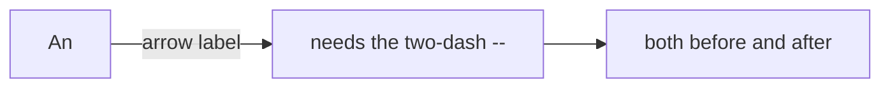


#### Subgraphs

A subgraph is putting nodes in a named box. For a subgraph you can write `subgraph The Subgraph Title` and `end`. The big gotcha here is that `flowchart` does NOT get an `end`. Only `subgraph` gets an `end`.

To keep things tidy, any links between subgraphs (like `b --> c` here) I do on their own line outside of the subgraphs, so there’s no confusion what is inside or outside each subgraph.

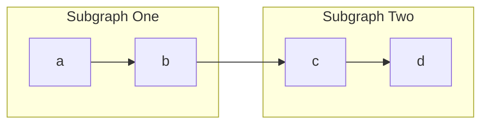


#### Graph Title

Mermaid doesn’t have a way as of December 29, 2021 to put a title on your graph. It’s a requested feature, but in the meantime you can sorta get a title by using a subgraph like this. Directions like `TB` and `LR` get a little wonky here, they seem backwards and I’m not sure what’s going on. I do use this trick a lot though!

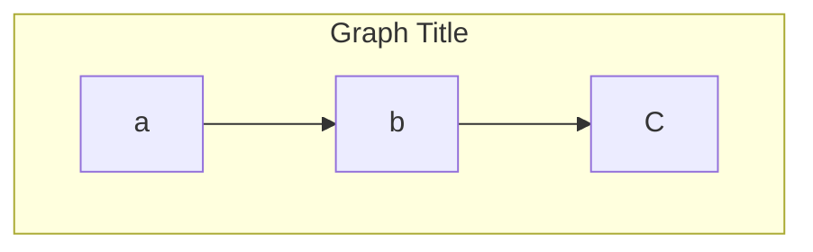


#### Top to Bottom, Left to Right, Etc

At the top of every mermaid chart, you have to write something like `flowchart TB`. Why? This does two things.

The `flowchart` part specifies what diagram type you want, since mermaid has many types of diagrams.

The next part (`TB` or `LR`, etc) specifies the direction the graph should go, like top-to-bottom or left-to-right. If you omit the direction part and just write `flowchart`, then `TB` will be assumed.

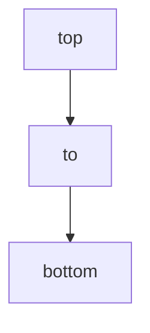


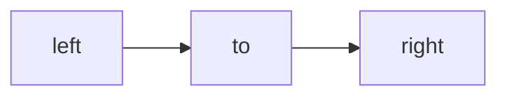


You may see some examples use `graph` instead of `flowchart`. This is because mermaid recently upgraded! `flowchart` recently replaced `graph`, and the docs were mostly updated summer 2021. The two are just about same to us, at least for now.

### Styling

#### Custom Themes

You can inject your own fonts, colors, and other styles by using a special line at the top. Mermaid has a pretty great algorithm for choosing nice related colors based on primaryColor, like the box border being a related, darker color.

Check out the mermaid docs on theming. 

My go-to theme is this one:

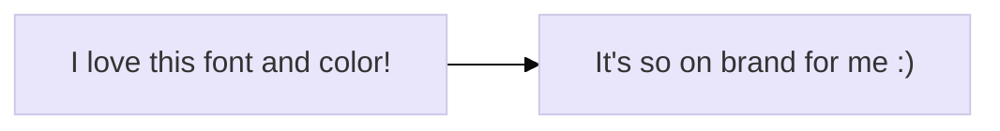


#### Box Shapes

There are a lot of shapes to choose from!

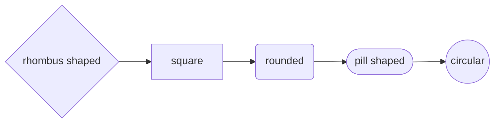


#### Box Styling

Mermaid supports reusable styles, based on css styles for svgs. I often use these to bring attention to specific parts of my diagrams, like Storytelling With Data would have us do. Check out the mermaid docs for styling and classes.

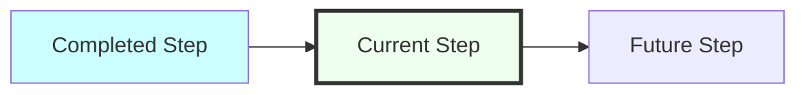


My mental image mnemonic for this is: the things on the right get dumped (passed) into the things to its left. Styles like `fill` get dumped into classes like `completed`. Classes like `completed` get dumped into the box/node ids, like `1`.

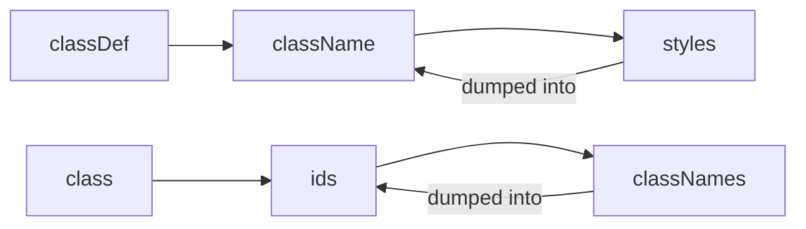


#### More Goodies

There is a lot more in the mermaid docs for flowchart. I’m impressed with these docs, they’re pretty easy to read through!

Also check out mermaid’s other graph types!

## Post-Tutorial

There’s a bit of a learning curve to mermaid. The best way to get good at a skill like this is to practice. Also to get familiar with the mermaid documentation. I hope the tips help you get started!

### Homework

Try it! I dare you to make make something with mermaid flowchart, either in Notion or on mermaid.live (see Mermaid Setup).

Some ideas to diagram:

- The lyrics to “Hey Jude” by the Beatles.
- What does your morning workflow look like? How does it vary by weekday vs weekend?
- How do your company’s users find out about your product?